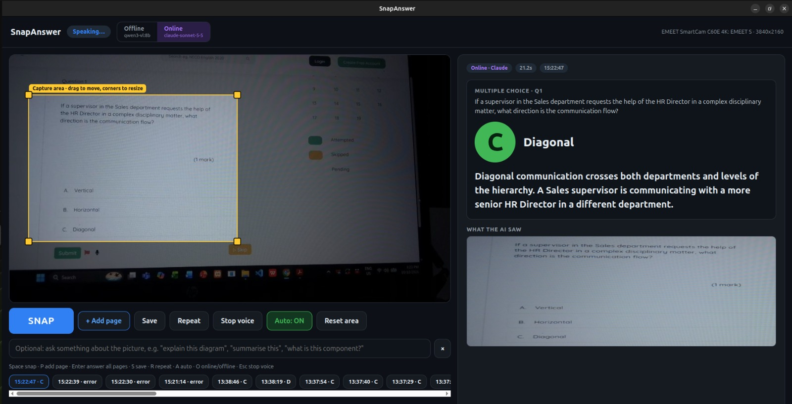

# SnapAnswer

Point a camera at a question, press one button, and get a clear answer on screen and read out loud.

SnapAnswer is a small AI system that runs on an NVIDIA DGX Spark with a USB webcam. It reads what is in front of the camera, works out the answer, shows it in large text on a browser dashboard and speaks it through a speaker. It handles multiple-choice questions, written (theory) questions, several pages at once, and things that are not questions at all, such as a diagram you want explained.



---

## Contents

- [What it does](#what-it-does)
- [How it works](#how-it-works)
- [What you need](#what-you-need)
- [Quick start](#quick-start)
- [Using the dashboard](#using-the-dashboard)
- [Online and offline modes](#online-and-offline-modes)
- [Configuration](#configuration)
- [Project structure](#project-structure)
- [Running on other hardware](#running-on-other-hardware)
- [Troubleshooting](#troubleshooting)
- [Privacy and cost](#privacy-and-cost)
- [Building your own version](#building-your-own-version)
- [Credits](#credits)

---

## What it does

- **Multiple-choice questions:** picks the correct letter, shows the option, and gives a short reason based on the actual fact or calculation.
- **Theory questions:** answers in at most three short sentences. No repeating the question, no filler.
- **Anything else:** if there is no question in the picture (a circuit diagram, a paragraph, a chart, some code, a component), it explains what it is. You can also type a request such as "summarise this" or "what is this component?".
- **Several pages at once:** capture page after page, then answer them together. A question that starts on one page and finishes on the next is treated as one question.
- **Online or offline:** use Claude through the API for fast, very accurate answers, or run fully offline with local models on the Spark. If online fails, it falls back to offline by itself.
- **Spoken answers:** every answer is read aloud with a natural-sounding local voice (Kokoro).
- **Sharp captures:** each snap uses the sharpest of the last few camera frames, so a little hand shake does not blur the text.
- **Auto-capture:** optionally, it snaps by itself when a page is held still, then waits for the next page.
- **Runs like an app:** starts automatically when you log in, has a desktop icon, and can be opened from a phone or laptop on the same Wi-Fi.

## How it works

```
 Webcam (4K)          Dashboard (browser)              AI                          Output
 ───────────          ───────────────────              ──                          ──────
 live video  ──►  you frame the question  ──►  Online:  Claude reads and     ──►  answer cards
                  in the yellow box and          answers in one request         on screen
                  press SNAP                     Offline: Qwen3-VL reads the
                                                 page, then answers each    ──►  spoken by
                                                 question locally                Kokoro voice
```

1. The camera streams live video to a small web server (`dashboard.py`) running on the Spark.
2. When you press **SNAP**, it takes the sharpest recent frame and crops it to the yellow capture box.
3. The crop goes to the AI:
   - **Online:** one call to the Claude API with the photo(s). Claude reads every question and returns structured answers.
   - **Offline:** a local vision model (`qwen3-vl:8b` through Ollama) copies out the questions, then answers each one.
4. The answers appear on the dashboard and are spoken through the Spark's speaker.

## What you need

### Hardware

| Part                | What we used                         | Notes                                                                           |
| ------------------- | ------------------------------------ | ------------------------------------------------------------------------------- |
| Computer            | NVIDIA DGX Spark (ARM64, DGX OS)     | Any Ubuntu 22.04/24.04 machine works. A GPU makes offline mode much faster.     |
| Camera              | EMEET SmartCam C60E 4K (model E3124) | Any UVC webcam works. 4K with autofocus gives the sharpest text.                |
| Camera (optional)   | Intel RealSense D435i                | Also supported, and adds depth-based auto-capture. Needs an extra driver build. |
| Speaker             | Any USB or HDMI speaker              | Plugged into the Spark, not into the laptop you browse from.                    |
| Mount (recommended) | Small tripod or arm                  | Point the camera straight down at the desk from 30 to 40 cm.                    |

### Accounts (optional)

- **Claude API key** for Online mode, from [console.anthropic.com](https://console.anthropic.com). API usage is billed separately from Claude Pro/Max subscriptions. Offline mode needs no account.

### Software (installed for you by the setup script)

Python 3, OpenCV, Flask, Ollama with `qwen3-vl:8b`, Kokoro TTS, the Anthropic Python SDK, and optionally the Intel RealSense SDK.

## Quick start

These steps take you from a fresh machine to a working SnapAnswer app. Most of the time is spent downloading models.

### 1. Get the code

```bash
git clone https://github.com/olawalekaybee/snapanswer.git
cd snapanswer
```

### 2. Run the setup script (once)

```bash
bash setup_spark.sh
```

This installs the system packages, creates a Python environment at `~/snapanswer-venv`, installs Ollama, downloads the offline vision model and the voice, and checks that your webcam is visible.

Optional extras:

```bash
WITH_REALSENSE=1 bash setup_spark.sh   # if you use an Intel RealSense D435/D435i
WITH_BIG_MODEL=1 bash setup_spark.sh   # adds gpt-oss:20b for stronger offline answers
```

### 3. Add your Claude API key (optional, for Online mode)

```bash
echo "sk-ant-your-key-here" > .anthropic_key
chmod 600 .anthropic_key
```

The file holds only the key, on one line. It is listed in `.gitignore`, so it never gets pushed to GitHub.

### 4. Try it

```bash
source ~/snapanswer-venv/bin/activate
python dashboard.py
```

Open **http://localhost:8000** in a browser on the Spark. The top-right corner should show your camera, for example `EMEET SmartCam C60E 4K · 3840x2160`. Put a question inside the yellow box and press **SNAP**.

Press `Ctrl+C` in the terminal to stop it.

### 5. Install it as an app

```bash
bash install_app.sh
```

This sets SnapAnswer up as a background service that starts every time you log in, and adds a **SnapAnswer** icon to the app menu and the desktop. Click the icon and the dashboard opens in its own window. The installer also prints an address such as `http://192.168.1.50:8000`, which you can open from a phone or laptop on the same Wi-Fi.

From now on you never need a terminal to use it. Just click the icon.

## Using the dashboard

| Control                    | What it does                                                                                                                            |
| -------------------------- | --------------------------------------------------------------------------------------------------------------------------------------- |
| **Yellow box**       | The capture area. Drag it to move it, drag the corners to resize. Only what is inside is sent to the AI. It is remembered between runs. |
| **SNAP**             | Captures the box and answers straight away.                                                                                             |
| **+ Add page**       | Adds the current page to a batch. Do this for each page.                                                                                |
| **Answer all**       | Appears once you have added pages. Answers the whole batch together.                                                                    |
| **Ask box**          | Optional. Type what you want, for example "explain this diagram". Applies to SNAP and Answer all.                                       |
| **Online / Offline** | Chooses where the AI runs (see below).                                                                                                  |
| **Save**             | Copies the photos and a text file with the questions and answers into`saved/`.                                                        |
| **Repeat**           | Reads the last answer again.                                                                                                            |
| **Stop voice**       | Stops speaking.                                                                                                                         |
| **Cancel**           | Appears while it is working. Abandons the current request.                                                                              |
| **Auto**             | Snaps by itself when a page is held still. Take the page away and bring the next one.                                                   |
| **History**          | The row of buttons under the controls. Click one to see an earlier answer.                                                              |

### Keyboard shortcuts

| Key       | Action                |
| --------- | --------------------- |
| `Space` | Snap                  |
| `P`     | Add page              |
| `Enter` | Answer all pages      |
| `S`     | Save                  |
| `R`     | Repeat                |
| `A`     | Auto-capture on/off   |
| `O`     | Switch online/offline |
| `Esc`   | Stop voice            |

### Tips for good results

- Light the page evenly and avoid glare.
- Keep the page flat and fill most of the yellow box with it.
- For screens, turn the brightness up and tilt the screen slightly to avoid reflections. If you see wavy lines in the photo, move the camera a little closer or further away.
- Check the photo under **What the AI saw**. If an answer is wrong, this tells you straight away whether the picture or the reasoning was the problem.

## Online and offline modes

|          | Online                                                              | Offline                                       |
| -------- | ------------------------------------------------------------------- | --------------------------------------------- |
| Runs on  | Claude API (`claude-sonnet-5-5` by default)                       | Your machine (`qwen3-vl:8b` through Ollama) |
| Speed    | A few seconds for a whole page                                      | Slower, depends on your GPU                   |
| Accuracy | Highest, especially for maths, engineering and multi-page questions | Good for general questions                    |
| Internet | Required                                                            | Not needed                                    |
| Cost     | Pay per use (small per snap)                                        | Free                                          |
| Privacy  | Photos are sent to the Claude API                                   | Nothing leaves the machine                    |

If an online request fails (no internet, for example), SnapAnswer answers offline instead and shows a yellow note explaining why.

## Configuration

Settings you change on the dashboard (capture box, online/offline) are saved in `settings.json` automatically. Everything else is a command-line option of `dashboard.py`.

| Option                             | Default               | What it does                                                                     |
| ---------------------------------- | --------------------- | -------------------------------------------------------------------------------- |
| `--port`                         | `8000`              | Web port for the dashboard                                                       |
| `--mode`                         | `offline`           | Starting mode the first time (after that, your last choice is remembered)        |
| `--online-model`                 | `claude-sonnet-5-5` | Claude model for online mode.`claude-haiku-5-5` is faster and cheaper.         |
| `--vision-model`                 | `qwen3-vl:8b`       | Offline model that reads the page                                                |
| `--reasoner`                     | same as vision model  | Offline model that answers, for example`gpt-oss:20b`                           |
| `--think`                        | none                  | Reasoning effort for thinking models, for example`medium` for gpt-oss          |
| `--voice`                        | `bm_george`         | Kokoro voice:`bm_george`, `bf_emma`, `am_michael`, `af_heart` and others |
| `--speed`                        | `1.0`               | Speaking speed                                                                   |
| `--tts`                          | `kokoro`            | `kokoro`, `piper` or `none`                                                |
| `--camera`                       | `auto`              | `auto` (EMEET or other webcam first, then RealSense), `uvc` or `realsense` |
| `--uvc`                          | none                  | Force a specific webcam, for example`0` for `/dev/video0`                    |
| `--uvc-width` / `--uvc-height` | `3840` / `2160`   | Webcam resolution to request                                                     |
| `--auto`                         | off                   | Start with auto-capture on                                                       |
| `--hold`                         | `1.2`               | Seconds a page must be still before auto-capture fires                           |
| `--max-pages`                    | `10`                | Maximum pages in one batch                                                       |
| `--max-questions`                | `8`                 | Maximum questions answered per page                                              |

To change an option for the installed app, edit the `ExecStart=` line in `~/.config/systemd/user/snapanswer.service`, then run:

```bash
systemctl --user daemon-reload
systemctl --user restart snapanswer
```

## Project structure

```
snapanswer/
├── dashboard.py        Main app: web server, camera thread, capture, answering, history
├── snapanswer.py       Cameras (webcam and RealSense), offline AI (Ollama), voice (Kokoro).
│                       Also runs on its own as a terminal-only version.
├── online.py           Online mode: sends the photo(s) to the Claude API
├── web/
│   └── index.html      The dashboard page (plain HTML, CSS and JavaScript, no build step)
├── docs/
│   └── dashboard.png   Screenshot used in this README
├── setup_spark.sh      One-time installer
├── install_app.sh      Installs the background service and the SnapAnswer icon
├── requirements.txt    Python packages
└── .gitignore          Keeps keys, photos and local settings out of git
```

Created when it runs (not in git):

```
captures/        Every photo taken, with a JSON file of what the AI read and answered
saved/           Photos and answers you chose to keep with the Save button
settings.json    Your capture box and mode
.anthropic_key   Your Claude API key
```

## Running on other hardware

- **Other Ubuntu PCs (x86_64 or ARM64):** the same steps work. `setup_spark.sh` uses only standard Ubuntu packages. Without an NVIDIA GPU, offline mode will be slow, so Online mode is the better default.
- **Other webcams:** any UVC webcam works. SnapAnswer prefers a camera with "EMEET" in its name, then falls back to any other webcam. Force a specific one with `--uvc N` (find `N` with `v4l2-ctl --list-devices`).
- **Intel RealSense D435/D435i:** run `WITH_REALSENSE=1 bash setup_spark.sh`. Use a USB 3 port and cable. On USB 2 the camera is limited to 720p and can disconnect.
- **Raspberry Pi 5:** online mode works well. Offline models are too heavy for it.

## Troubleshooting

**The SnapAnswer window says "refused to connect"**
The background service is not running. Check it and read the log:

```bash
systemctl --user status snapanswer
journalctl --user -u snapanswer -n 40 --no-pager
```

**"Camera not available. Retrying…" over the video**
Another program is using the camera, or it is unplugged. Close any other camera apps (and any copy of `dashboard.py` running in a terminal), unplug and replug the camera, and it reconnects by itself. Only run one copy of SnapAnswer at a time.

**The wrong camera is used**
Run `v4l2-ctl --list-devices` and force the right one with `--camera uvc --uvc N`.

**Lower resolution than expected**
Try another USB port. For the RealSense, use a blue USB 3 port and a USB 3 data cable.

**Online mode says "Online failed"**
The yellow note shows the reason. Test your key with:

```bash
python -c "import anthropic; k=open('.anthropic_key').read().strip(); print(anthropic.Anthropic(api_key=k).messages.create(model='claude-sonnet-5-5',max_tokens=20,messages=[{'role':'user','content':'Say OK'}]).content[0].text)"
```

`OK` means the key works. An authentication error means the key file is wrong. A billing error means you need to add credit in the Console.

**Offline mode is slow or says it cannot read the page**
The first offline answer after a restart is slow while the model loads. Make sure Ollama is running (`systemctl status ollama`) and that `ollama list` shows `qwen3-vl:8b`.

**No sound**
The voice plays on the machine running SnapAnswer, not on the device you browse from. Check the speaker with `pactl list short sinks` and make sure the right output is selected.

**After updating the code**

```bash
systemctl --user restart snapanswer
```

Then reopen the SnapAnswer window. To remove the app setup (your files stay), run `bash install_app.sh --uninstall`.

## Privacy and cost

- In **Offline** mode, everything stays on your machine.
- In **Online** mode, the cropped photo is sent to the Claude API to be answered. Nothing else is sent.
- Your API key, photos, saved answers and settings are excluded from git by `.gitignore`. Check with `git status` before your first push.
- Online usage is charged per request by Anthropic. One snap is a single small request. You can watch your usage and set limits in the Claude Console.

## Building your own version

SnapAnswer is deliberately small: about four files, no frameworks beyond Flask, and no build step. If you want to adapt it:

- **Change how answers are written:** edit the prompts. `SYSTEM` in `online.py` controls online answers. `ANSWER_SYSTEM`, `MCQ_TEMPLATE` and `THEORY_TEMPLATE` in `snapanswer.py` control offline answers.
- **Use a different AI model:** pass `--online-model` or `--vision-model`/`--reasoner`. Any Ollama vision model can be used offline.
- **Use a different camera:** add a class with `read()` returning `(frame, distance_or_None)`, `close()`, `has_depth` and `info`, then return it from `open_camera()` in `snapanswer.py`.
- **Change the voice:** swap the `Voice` class in `snapanswer.py` for another text-to-speech engine. It only needs `say(text)`, `stop()` and `idle()`.
- **Change the dashboard:** everything is in `web/index.html`. It talks to the server through a few simple endpoints: `GET /state`, `GET /video`, `POST /snap`, `POST /page/add`, `POST /page/answer`, `POST /mode`, `POST /roi` and `POST /save`.

## Credits

- [Claude](https://www.anthropic.com) by Anthropic for online answers
- [Ollama](https://ollama.com) and [Qwen3-VL](https://github.com/QwenLM) for offline vision and answers
- [Kokoro TTS](https://huggingface.co/hexgrad/Kokoro-82M) for the voice
- [OpenCV](https://opencv.org) and [Flask](https://flask.palletsprojects.com)
- [Intel RealSense SDK](https://github.com/IntelRealSense/librealsense) for optional RealSense support

Built by Olawale Kabiru Balogun.
